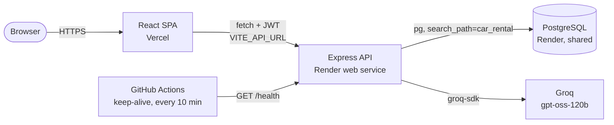

# Ridex: self-drive car rentals with live availability

Pick your dates first, see only the cars that are actually free, and book them in a transaction that makes double bookings impossible.

**Live demo:** [ridex.vercel.app](https://ridex.vercel.app) (placeholder, replace with your Vercel URL) · **API:** [ridex-api.onrender.com/health](https://ridex-api.onrender.com/health) (placeholder, replace with your Render URL)

> Demo login: `demo@ridex.app` / `ridex-demo-2026` (the sign-in page has a one-click "Fill in demo details" button).
> The API runs on Render's free tier, so the first request after a quiet spell can take 30-60 seconds; the app shows a "waking up the server" banner while it does.

## Features

- **Date-first search.** Filter the fleet by city, type, seats, budget and free text; add pick-up and return dates and booked cars drop out of the results.
- **Live availability calendar.** Each car shows a four-week strip of free and booked days. Tap a pick-up day, tap a return day, and the quote updates.
- **Overlap-safe bookings.** `POST /api/bookings` locks the car row (`SELECT ... FOR UPDATE`) before checking for overlaps and inserting, so concurrent requests for the same dates cannot both succeed. A test fires six at once and expects exactly one `201`.
- **Server-side pricing.** The total is always computed by the API from the car's daily rate; the client's number is only a preview.
- **Accounts and trips.** JWT auth with bcrypt-hashed passwords. "My trips" splits upcoming and past trips, and upcoming trips can be cancelled (which frees the dates).
- **AI trip advisor.** Describe a trip in plain words; the API asks Groq (`openai/gpt-oss-120b`) to pick up to three cars from the live fleet and explain why. The response is checked against real car ids, and the feature degrades gracefully if the key is missing or rate-limited.
- **Production hygiene.** zod validation on every endpoint, consistent JSON errors, helmet headers, a CORS allow-list, rate limits on auth and AI, schema-scoped migrations and an idempotent seed.
- **Polished, accessible UI.** A design system built from [`docs/style-guide.md`](docs/style-guide.md), skeleton/empty/error states, toasts, visible focus, labelled fields and AA contrast, responsive down to 375px.

## Screenshots

| Home | Booking |
| --- | --- |
|  |  |
| **Fleet** | **My trips** |
|  |  |

Mobile: [home](docs/screenshots/home-mobile.png) · [car details](docs/screenshots/details-mobile.png)

## Architecture



The database is shared with other projects, so every table lives in its own Postgres schema (`DB_SCHEMA`, default `car_rental`). Migrations run `CREATE SCHEMA IF NOT EXISTS` and every connection sets `search_path` to that schema.

## Tech stack

| Layer | Tools |
| --- | --- |
| Frontend | React 19, React Router 7, Vite 7, plain CSS with design tokens, Ionicons |
| Backend | Node.js 22+, Express 5, zod 4, jsonwebtoken, bcryptjs, helmet, express-rate-limit |
| Data | PostgreSQL (node-postgres), SQL migrations, idempotent seed |
| AI | Groq via `groq-sdk`, server-side only |
| Quality | Vitest, Supertest (against a real Postgres), ESLint, Prettier, GitHub Actions |
| Hosting | Vercel (web), Render (API + PostgreSQL) |

## Local setup

Prerequisites: Node.js 22.9+ and a PostgreSQL database (for example `docker run -p 5433:5432 -e POSTGRES_PASSWORD=postgres -e POSTGRES_DB=portfolio postgres:16`).

```bash
# API on http://localhost:5112
cd backend
cp .env.example .env        # then set DATABASE_URL, and GROQ_API_KEY if you want the advisor
npm install
npm run seed                # runs migrations, then seeds cars, demo user and bookings
npm run dev

# Web app on http://localhost:5206
cd ../frontend
cp .env.example .env
npm install
npm run dev
```

Checks:

```bash
cd backend && npm run lint && npm run format:check && npm test    # tests use a throwaway car_rental_test schema
cd frontend && npm run lint && npm run format:check && npm test && npm run build
```

## Environment variables

| Variable | Where | Required | Description |
| --- | --- | --- | --- |
| `DATABASE_URL` | backend | yes | PostgreSQL connection string |
| `DB_SCHEMA` | backend | no | Schema for this app's tables. Default `car_rental` |
| `JWT_SECRET` | backend | in production | Secret for signing session tokens (a dev fallback is used locally) |
| `FRONTEND_URL` | backend | yes in production | Allowed CORS origin(s), comma-separated. Default `http://localhost:5206` |
| `GROQ_API_KEY` | backend | no | Enables the AI trip advisor. Without it the endpoint returns `503 AI_UNAVAILABLE` |
| `PORT` | backend | no | Default `5112` (Render sets this) |
| `NODE_ENV` | backend | no | `production` on Render |
| `VITE_API_URL` | frontend | yes in production | Base URL of the API, e.g. `https://ridex-api.onrender.com` |

## API

| Method | Path | Auth | Description |
| --- | --- | --- | --- |
| GET | `/health` | | `{"status":"ok","db":"ok"}`, or `503` if the database is unreachable |
| POST | `/api/auth/register` | | `{ name, email, password }` → `{ token, user }` |
| POST | `/api/auth/login` | | `{ email, password }` → `{ token, user }` |
| GET | `/api/auth/me` | Bearer | Current user |
| GET | `/api/cars` | | Filters: `q`, `city`, `category`, `seats`, `maxPrice`, `minYear`, `from` + `to` (only cars free for that range) |
| GET | `/api/cars/:id` | | One car |
| GET | `/api/cars/:id/availability` | | Booked ranges from today on (no customer data) |
| POST | `/api/bookings` | Bearer | `{ carId, startDate, endDate }`; `409 DATES_UNAVAILABLE` on overlap |
| GET | `/api/bookings/me` | Bearer | My bookings with car summary |
| POST | `/api/bookings/:id/cancel` | Bearer | Cancel an upcoming booking |
| POST | `/api/ai/recommend` | | `{ message }` → `{ reply, carIds }` |

Dates are `YYYY-MM-DD`, and the return date is exclusive: a car returned on the 14th can be picked up by someone else on the 14th. Errors always look like `{ "error": { "code", "message", "details?" } }`.

## Deploy

1. **Database.** Use the shared Render PostgreSQL instance (create it once by hand if it does not exist). Copy its *Internal Database URL*.
2. **API on Render.** New → Blueprint → pick this repo; Render reads [`render.yaml`](render.yaml) and creates `ridex-api` (root `backend/`, health check `/health`). Fill in the prompted values: `DATABASE_URL` (the shared database), `FRONTEND_URL` (your Vercel URL) and `GROQ_API_KEY`. `JWT_SECRET` is generated for you. Each boot runs migrations and the idempotent seed.
3. **Web on Vercel.** Import the repo, set **Root Directory** to `frontend`, framework Vite, and add `VITE_API_URL` = your Render URL. [`frontend/vercel.json`](frontend/vercel.json) handles SPA rewrites and headers.
4. **Keep-alive.** In GitHub → Settings → Secrets and variables → Actions → *Variables*, add `BACKEND_URL` = your Render URL. [`keep-alive.yml`](.github/workflows/keep-alive.yml) pings `/health` every 10 minutes so the free instance stays warm.
5. Update the live-demo links at the top of this README.

## Project structure

```text
.
├── backend/                 Express API
│   ├── src/
│   │   ├── app.js           middleware, routes, error handling
│   │   ├── config.js        env parsing and validation
│   │   ├── db/              pool, migrate.js, seed.js, migrations/*.sql
│   │   ├── routes/          auth, cars, bookings, ai, health
│   │   └── services/        booking transaction, car queries, pricing, Groq advisor
│   └── test/                Vitest + Supertest suites
├── frontend/                React SPA
│   ├── public/images/       car photos, hero and logo
│   └── src/
│       ├── components/      cards, availability picker, advisor, providers, states
│       ├── lib/             API client, hooks, date and price helpers
│       ├── pages/           Home, Cars, CarDetails, Trips, Login, Register, About
│       └── styles/main.css  design tokens and components
├── docs/                    style guide, screenshots, original academic report
├── render.yaml              Render Blueprint
└── .github/workflows/       CI and keep-alive
```

## Credits

Built by [Harsh Bathija](https://github.com/HarshBathija-04). The visual language (palette, Nunito and Open Sans, Ionicons) started from the open-source "Ridex" template by codewithsadee and is documented in [`docs/style-guide.md`](docs/style-guide.md). The original academic write-up is in [`docs/academic-report.md`](docs/academic-report.md).
