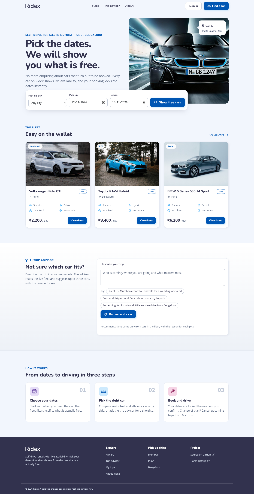
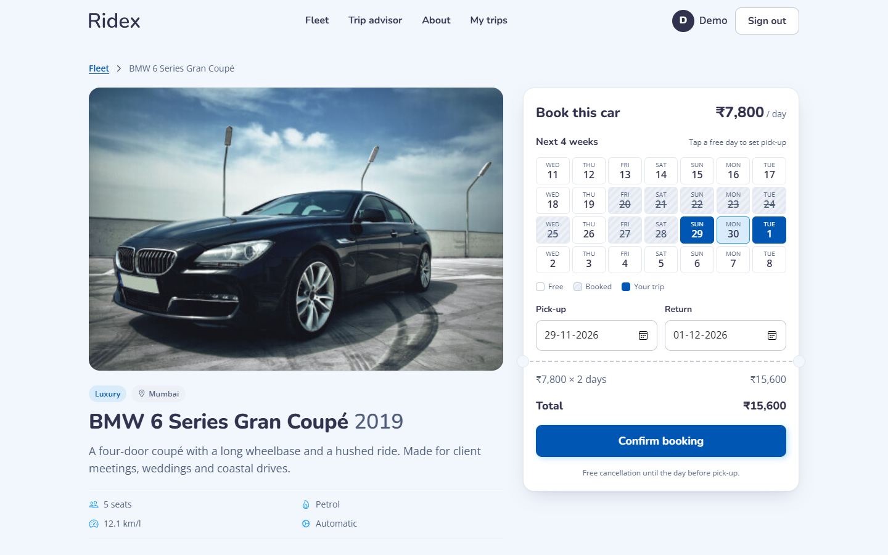
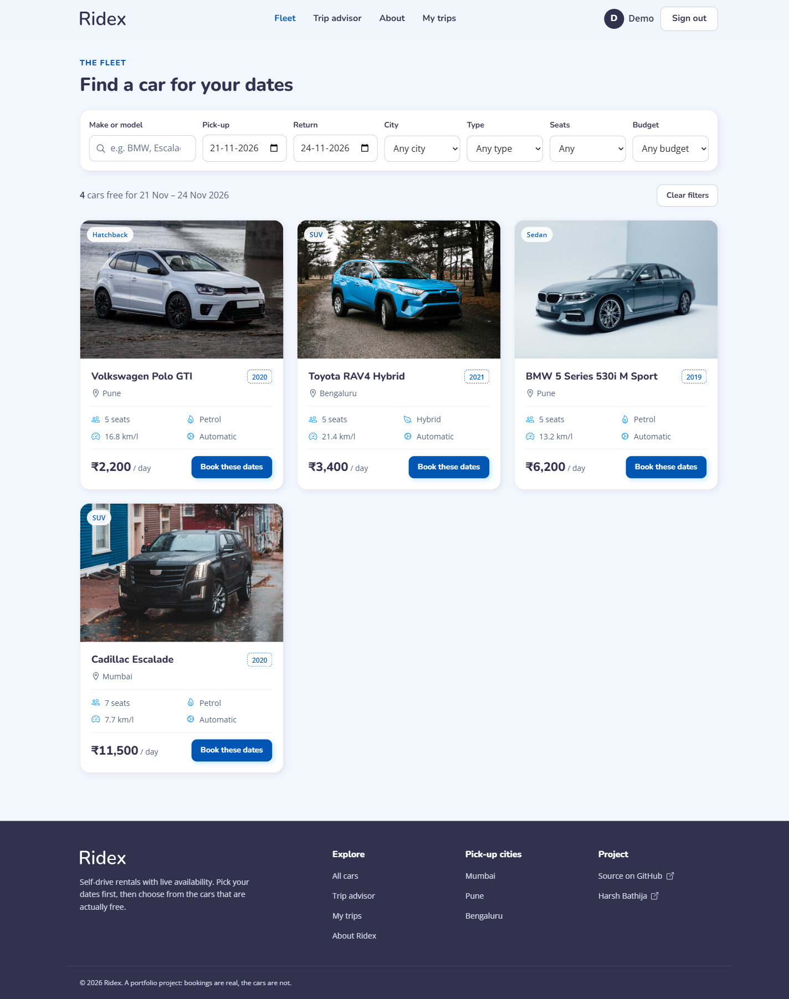
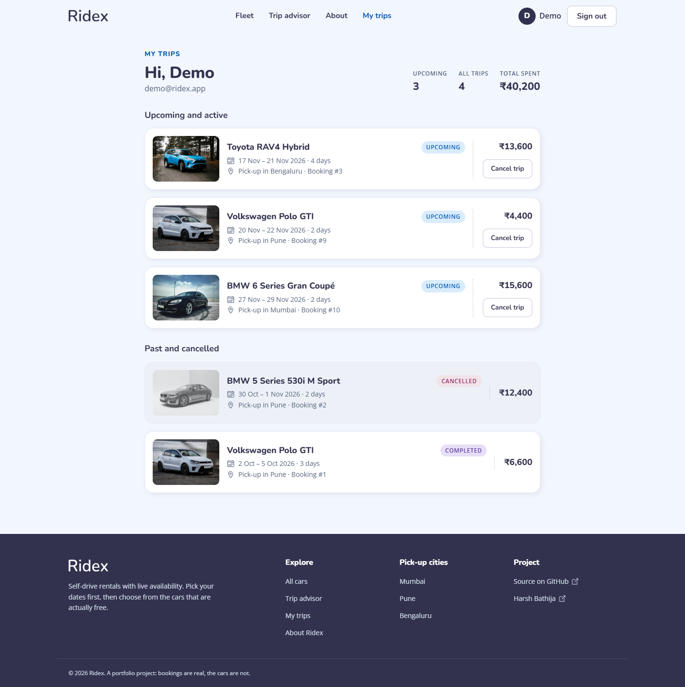
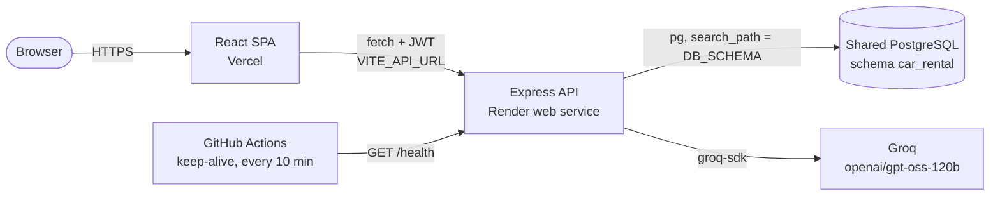

# Ridex

**Self-drive car rentals with live availability: pick your dates, see only the cars that are free, book without double bookings.**

[](https://github.com/HarshBathija-04/Car-Rental-Platform/actions/workflows/ci.yml)

**Live demo:** `https://<your-app>.vercel.app` (placeholder) · **API health:** `https://<your-api>.onrender.com/health` (placeholder)

> **Demo login:** `demo@ridex.app` / `ridex-demo-2026`, or use the "Fill in demo details" button on the sign-in page.
> The API runs on Render's free tier. If it has been idle, the first request can take 30 to 60 seconds and the app shows a "Waking up the server" banner.

## Features

- **Date-first search.** Filter by city, type, seats, budget and make or model. Add dates and booked cars drop out.
- **Availability calendar.** Every car shows four weeks of free and booked days. Tap a pick-up day, then a return day, and the price updates.
- **No double bookings.** Bookings run in a transaction that locks the car row, so two requests for the same dates cannot both succeed.
- **Accounts and trips.** JWT sign-in with bcrypt-hashed passwords. "My trips" lists upcoming and past trips, and upcoming ones can be cancelled.
- **AI trip advisor.** Describe a trip in plain words. Groq picks up to three cars from the real fleet and says why.
- **Accessible, responsive UI.** Skeleton, empty and error states, toasts, visible focus, labelled fields, AA contrast, works at 375px.

## Screenshots

| Home | Booking |
| --- | --- |
|  |  |
| **Fleet** | **My trips** |
|  |  |

Mobile: [home](docs/screenshots/home-mobile.png) · [car details](docs/screenshots/details-mobile.png)

## Architecture



## Engineering highlights

- **Transaction-safe bookings.** `POST /api/bookings` runs `SELECT ... FOR UPDATE` on the car, checks for overlaps, then inserts, all in one transaction. A test sends six requests at once for the same dates and expects one `201` and five `409`s.
- **Schema-per-app database.** Several portfolio apps share one Postgres instance. This one keeps its tables in its own schema (`DB_SCHEMA`, default `car_rental`): migrations run `CREATE SCHEMA IF NOT EXISTS`, every pooled connection sets `search_path`, and the schema name is checked against a strict identifier pattern before it goes into DDL.
- **Half-open date ranges.** Rentals are `[pick-up, return)`, so a car returned on the 14th can go out again on the 14th. The same rule is used in SQL, in the API and in the calendar.
- **India time, wherever the server runs.** "Today" is the calendar date in `Asia/Kolkata`, so a pick-up date that has already passed in India is rejected even while it is still the day before in UTC.
- **Server-side prices.** The API always computes the total from the car's daily rate. The number in the browser is only a preview.
- **AI kept on a leash.** The model only sees the fleet as JSON, must answer in JSON, and any car id it returns that is not in the fleet is dropped. A missing key or a Groq rate limit returns a clear `503` or `429`, never a crash.
- **Safe migrations and seed.** Migrations take a Postgres advisory lock and run each file in its own transaction. The seed is idempotent and re-adds upcoming demo trips once the demo account has none left, so it is safe to run on every boot.
- **Hardened API.** zod validation at every endpoint, one JSON error shape, helmet headers, a CORS allow-list, a 20 kB body limit and rate limits on sign-in, sign-up and the advisor.

## Tech stack

| Layer | Tools |
| --- | --- |
| Frontend | React 19, React Router 7, Vite 7, plain CSS with design tokens, Ionicons |
| Backend | Node.js 22, Express 5, zod 4, jsonwebtoken, bcryptjs, helmet, express-rate-limit |
| Data | PostgreSQL via node-postgres, plain SQL migrations |
| AI | Groq (`groq-sdk`), called only from the server |
| Quality | Vitest, Supertest against a real Postgres, ESLint, Prettier, GitHub Actions |
| Hosting | Vercel (web), Render (API), shared PostgreSQL |

## Quick start

You need Node.js 22.9+ and a PostgreSQL database, for example:

```bash
docker run -d -p 5433:5432 -e POSTGRES_PASSWORD=postgres -e POSTGRES_DB=portfolio postgres:16
```

```bash
# API on http://localhost:5112
cd backend
cp .env.example .env        # DATABASE_URL already points at the container above; add GROQ_API_KEY for the advisor
npm install
npm run seed                # runs migrations, then adds cars, the demo user and bookings
npm run dev

# Web app on http://localhost:5206 (in a second terminal)
cd frontend
cp .env.example .env
npm install
npm run dev
```

Run the checks:

```bash
cd backend && npm run lint && npm run format:check && npm test   # API tests use a throwaway car_rental_test schema
cd frontend && npm run lint && npm run format:check && npm test && npm run build
```

## Environment variables

| Variable | App | Required | Description |
| --- | --- | --- | --- |
| `DATABASE_URL` | backend | yes | PostgreSQL connection string |
| `DB_SCHEMA` | backend | no | Schema for this app's tables. Default `car_rental` |
| `JWT_SECRET` | backend | in production | Secret for signing session tokens. A dev-only fallback is used locally |
| `FRONTEND_URL` | backend | in production | Allowed CORS origins, comma-separated. Default `http://localhost:5206` |
| `GROQ_API_KEY` | backend | no | Turns on the AI trip advisor. Without it the endpoint returns `503 AI_UNAVAILABLE` |
| `PORT` | backend | no | Default `5112`. Render sets it for you |
| `NODE_ENV` | backend | no | Set to `production` on Render |
| `VITE_API_URL` | frontend | in production | API base URL, e.g. `https://<your-api>.onrender.com`. Default `http://localhost:5112` |

## API

| Method | Path | Auth | Description |
| --- | --- | --- | --- |
| GET | `/health` | | `{"status":"ok","db":"ok"}`, or `503` if the database is down |
| POST | `/api/auth/register` | | `{ name, email, password }` → `{ token, user }` |
| POST | `/api/auth/login` | | `{ email, password }` → `{ token, user }` |
| GET | `/api/auth/me` | Bearer | The signed-in user |
| GET | `/api/cars` | | Filters: `q`, `city`, `category`, `seats`, `maxPrice`, `minYear`, and `from` + `to` for cars free on those dates |
| GET | `/api/cars/:id` | | One car |
| GET | `/api/cars/:id/availability` | | Booked ranges from today on, with no customer data |
| POST | `/api/bookings` | Bearer | `{ carId, startDate, endDate }`. `409 DATES_UNAVAILABLE` on overlap |
| GET | `/api/bookings/me` | Bearer | My bookings with a car summary |
| POST | `/api/bookings/:id/cancel` | Bearer | Cancel a booking that has not started yet |
| POST | `/api/ai/recommend` | | `{ message }` → `{ reply, carIds }` |

Dates are `YYYY-MM-DD`. Errors always look like `{ "error": { "code", "message", "details?" } }`.

## Deploy

1. **Database.** Use the shared PostgreSQL instance (created once by hand) and copy its connection string.
2. **API on Render.** New → Blueprint → choose this repo. Render reads [`render.yaml`](render.yaml) and creates `ridex-api` from `backend/` with `DB_SCHEMA=car_rental` and a generated `JWT_SECRET`. When prompted, set `DATABASE_URL` to the shared database, `FRONTEND_URL` to your Vercel URL and `GROQ_API_KEY`. Each boot runs migrations and the seed, then starts the server.
3. **Web on Vercel.** Import the repo, set **Root Directory** to `frontend` (framework: Vite) and add `VITE_API_URL` = your Render URL. [`frontend/vercel.json`](frontend/vercel.json) adds SPA rewrites and security headers.
4. **Keep-alive.** In GitHub, open Settings → Secrets and variables → Actions → **Variables** and add `BACKEND_URL` = your Render URL. [`keep-alive.yml`](.github/workflows/keep-alive.yml) then calls `/health` every 10 minutes so the free instance stays awake.
5. Replace the live-demo placeholders at the top of this README.

## Project structure

```text
.
├── backend/                 Express API
│   ├── src/
│   │   ├── app.js           middleware, routes, rate limits
│   │   ├── config.js        env parsing and checks
│   │   ├── errors.js        HttpError and the JSON error handler
│   │   ├── db/              pool, migrate.js, seed.js, migrations/*.sql
│   │   ├── routes/          auth, cars, bookings, ai, health
│   │   └── services/        booking transaction, car queries, dates, Groq advisor
│   └── test/                Vitest unit tests and Supertest API tests
├── frontend/                React SPA
│   ├── public/images/       car photos, hero image, logo
│   └── src/
│       ├── components/      car cards, availability calendar, advisor, providers, states
│       ├── lib/             API client, hooks, date and price helpers
│       ├── pages/           Home, Cars, CarDetails, Trips, Login, Register, About
│       └── styles/main.css  design tokens and components
├── docs/                    style guide, screenshots, original academic report
├── render.yaml              Render Blueprint
└── .github/workflows/       CI and keep-alive
```

## Credits

Built by [Harsh Bathija](https://github.com/HarshBathija-04). The look (palette, Nunito and Open Sans, Ionicons) started from the open-source "Ridex" template by codewithsadee and is written up in [`docs/style-guide.md`](docs/style-guide.md). The original academic write-up is in [`docs/academic-report.md`](docs/academic-report.md).
